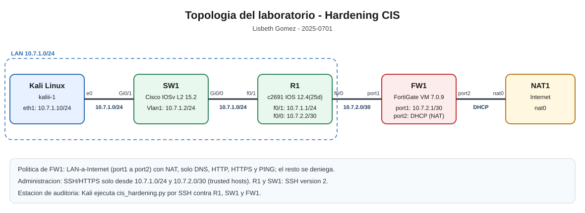
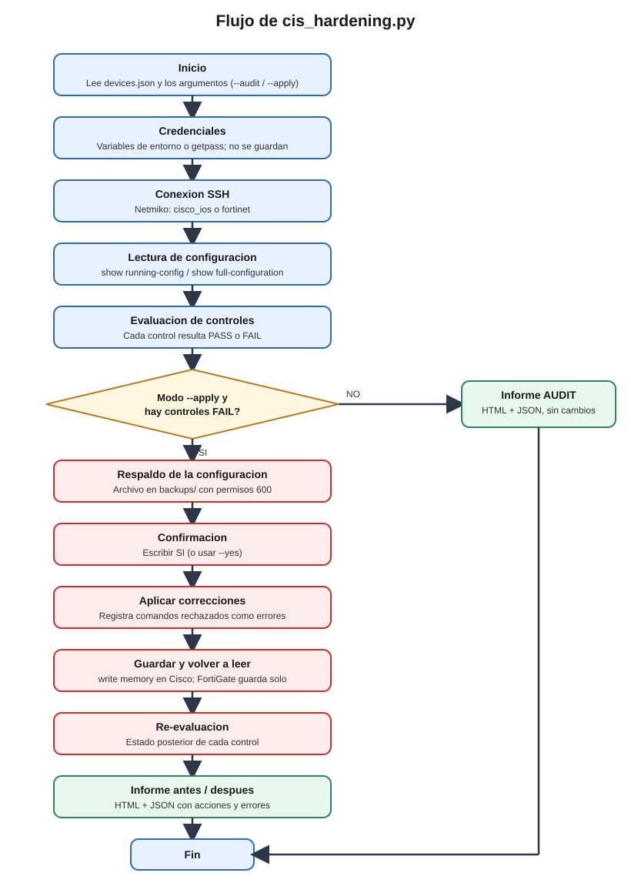

# 🛡️ Hardening de Redes con CIS Benchmark: Router, Switch y Firewall en GNS3

**Autora:** Lisbeth Gómez · **Matrícula:** 2025-0701

---

## 🎥 Video demostrativo

[▶️ Ver el video demostrativo en YouTube](URL_DEL_VIDEO)

---

## 1. Descripción general

Laboratorio de seguridad de redes en GNS3 con un **router Cisco**, un **switch Cisco** y un **firewall FortiGate**. Se evalúa la configuración de cada equipo con controles basados en recomendaciones del **CIS Benchmark**, se aplican medidas de hardening y se comprueba que funcionan. Un script de Python automatiza la auditoría y la aplicación de las reglas, y genera informes comparables antes y después.

## 2. Propósito del laboratorio

Demostrar, con evidencia real, el ciclo completo de hardening de una red: detectar configuraciones inseguras, corregirlas de forma controlada y verificar el resultado.

## 3. Objetivos

- Diseñar una red con router, switch y firewall.
- Evaluar los equipos con recomendaciones del CIS Benchmark.
- Aplicar hardening y documentar cada recomendación y su motivo.
- Probar que las medidas funcionan.
- Automatizar la auditoría y el hardening con un script con dos modos: solo informe, y aplicar con informe posterior.

## 4. Tecnologías y herramientas

| Herramienta | Uso |
|---|---|
| GNS3 | Simulación de la topología |
| Cisco IOS 12.4 (c2691) e IOSv L2 15.2 | Router y switch |
| FortiGate VM, FortiOS 7.0.9 | Firewall |
| Kali Linux | Estación de administración y pruebas |
| Python 3 y Netmiko | Script de auditoría y hardening |
| nmap, curl, netcat, OpenSSH | Pruebas |

Detalle y justificación en [docs/01-dispositivos-y-herramientas.md](docs/01-dispositivos-y-herramientas.md).

## 5. Arquitectura y topología de red

```
Kali ── SW1 ── R1 ── FW1 ── NAT1 (Internet)
```

- **SW1** (switch de acceso) y **R1** (router) forman la LAN `10.7.1.0/24`.
- **FW1** es el perímetro: aplica NAT y una política de salida restrictiva.
- **Kali** administra los equipos por SSH y ejecuta el script.

## 6. Diagrama de la infraestructura




*Figura 01 · Topología en GNS3.*

## 7. Direccionamiento IP

| Equipo | Interfaz | Dirección |
|---|---|---|
| Kali | eth1 | 10.7.1.10/24 |
| SW1 | Vlan 1 | 10.7.1.2/24 |
| R1 | f0/1 | 10.7.1.1/24 |
| R1 | f0/0 | 10.7.2.2/30 |
| FW1 | port1 | 10.7.2.1/30 |
| FW1 | port2 | DHCP (NAT de GNS3) |

Conexiones y flujo de tráfico en [docs/02-topologia-y-direccionamiento.md](docs/02-topologia-y-direccionamiento.md).

## 8. Metodología de trabajo

1. Selección de dispositivos, plataforma y herramienta.
2. Diseño de la topología y del direccionamiento.
3. Selección de las recomendaciones CIS.
4. Configuración inicial de los equipos.
5. Auditoría inicial con el script (`--audit`).
6. Aplicación del hardening (`--apply`).
7. Auditoría posterior.
8. Pruebas funcionales.
9. Documentación y evidencias.

Procedimiento paso a paso en [docs/04-procedimiento-y-pruebas.md](docs/04-procedimiento-y-pruebas.md).

## 9. Conexión inicial de los equipos


*Figura 02 · Conectividad desde Kali hacia R1, SW1, FW1 e Internet.*


*Figura 03 · Acceso SSH a FW1 mostrando el banner de advertencia.*

Las configuraciones iniciales están en [`configs/initial/`](configs/initial/).

## 10. CIS Benchmark seleccionados

- **Cisco (R1 y SW1):** CIS Cisco IOS Benchmark v2.2, aplicable a IOS 12.x o superior.
- **FortiGate (FW1):** CIS FortiGate 7.0.x Benchmark v1.3.0.

| Equipo | Controles evaluados | Con ID CIS | Adicionales |
|---|---|---|---|
| R1 y SW1 | 13 | 10 | 3 (H04, H11, H13) |
| FW1 | 10 | 6 | 4 (F04, F08, F10, F11) |

Los controles **Adicionales** son buenas prácticas que no tienen identificador en el benchmark utilizado. Tabla completa, con problema, riesgo, configuración inicial y segura, aplicación y verificación, en [docs/03-recomendaciones-cis.md](docs/03-recomendaciones-cis.md).

## 11. Medidas de hardening aplicadas

| Área | Medidas |
|---|---|
| Acceso remoto | SSH versión 2, VTY solo con SSH, HTTP y HTTPS apagados, timeouts de sesión |
| Credenciales | Cifrado de contraseñas, enable secret, política de contraseñas en FW1 |
| Protección contra fuerza bruta | `login block-for` en Cisco; bloqueo de 15 minutos tras 3 intentos en FW1 |
| Exposición de información | CDP apagado, banner de advertencia, sin source routing |
| Trazabilidad | Logs en buffer con fecha y hora |
| Perímetro | Política de FW1 con NAT que solo permite DNS, HTTP, HTTPS y PING; trusted hosts para el administrador |

## 12. Descripción de los scripts

[`scripts/cis_hardening.py`](scripts/cis_hardening.py) se conecta por SSH a cada equipo con Netmiko, lee su configuración y evalúa los controles seleccionados.

| Modo | Qué hace |
|---|---|
| `--audit` | Evalúa y genera el informe. **No modifica nada.** |
| `--apply` | Evalúa, respalda, pide confirmación, aplica las correcciones, vuelve a evaluar y genera el informe antes y después. |

Medidas de seguridad del script:

- No guarda contraseñas: se leen de variables de entorno o se piden con `getpass`.
- Respaldo de la configuración antes de modificarla (`backups/`, permisos 600).
- Confirmación antes de aplicar cambios (`--yes` para omitirla).
- Los errores de conexión y los comandos rechazados se registran en el informe.
- Cada informe incluye nombre e IP, fecha y hora, controles evaluados, estado, cambios aplicados, errores y resultado posterior.

**Alcance:** comprueba un conjunto seleccionado de recomendaciones. No es una auditoría CIS completa.



## 13. Instrucciones de instalación y ejecución

```bash
# 1. Dependencias (en Kali también sirve: apt install python3-netmiko)
cd scripts
pip install -r requirements.txt

# 2. Lista de equipos, sin contraseñas
cp devices.example.json devices.json

# 3. Credenciales por variable de entorno (o el script las solicita)
export CIS_PASS='<contraseña>'            # o CIS_PASS_R1, CIS_PASS_SW1, CIS_PASS_FW1
export CIS_ENABLE='<enable secret>'       # solo equipos Cisco

# 4. Auditoría sin cambios
python3 cis_hardening.py --devices devices.json --audit

# 5. Hardening con informe posterior (pide confirmación; --yes la omite)
python3 cis_hardening.py --devices devices.json --apply
```

Los informes se guardan en `reports/` (HTML y JSON) y los respaldos en `backups/`.

### Estructura del repositorio

```
CIS-Hardening-GNS3/
├── README.md
├── docs/            Documentación del laboratorio
├── images/
│   ├── diagramas/   Topología y flujo del script
│   └── capturas/    Evidencias numeradas
├── configs/
│   ├── initial/     Configuración inicial de cada equipo
│   └── running-config/  Configuración final exportada
├── scripts/         Script de auditoría y hardening
├── reports/
│   ├── before/      Informes de la auditoría inicial
│   └── after/       Informes posteriores al hardening
└── evidence/        Salidas de las pruebas
```

## 14. Auditoría inicial


*Figura 04 · Informe de la auditoría inicial de R1 y SW1.*


*Figura 05 · Informe de la auditoría inicial de FW1.*

## 15. Resultados de las auditorías

Cumplimiento de los **controles seleccionados** (no de todo el benchmark):

| Equipo | Auditoría inicial | Después del hardening | Controles que fallaban |
|---|---|---|---|
| R1 | 3/12 (25 %) | 12/12 (100 %) | H01, H04, H05, H06, H07, H08, H09, H10, H11 |
| SW1 | 3/12 (25 %) | 12/12 (100 %) | H01, H03, H04, H05, H07, H08, H09, H10, H11 |
| FW1 | 6/10 (60 %) | 10/10 (100 %) | F06, F07, F08, F09 |

La prueba de puertos con nmap mostró el puerto 443 abierto en SW1, lo que llevó a incorporar el control **H13** (HTTPS apagado). Con los 13 controles, SW1 pasó de 12/13 a 13/13 y R1 se mantuvo en 13/13.


*Figura 06 · Ejecución de `--apply`.*


*Figura 07 · Informe de `--apply` en R1 y SW1.*


*Figura 08 · Informe de `--apply` con el control H13.*


*Figura 09 · Informe de `--apply` en FW1.*

## 16. Comparación antes y después

| Equipo | Antes | Después |
|---|---|---|
| R1 | 3/12 (25 %) | 13/13 (100 %) |
| SW1 | 3/12 (25 %) | 13/13 (100 %) |
| FW1 | 6/10 (60 %) | 10/10 (100 %) |

La auditoría inicial de R1 y SW1 evaluó 12 controles; el estado final incluye los 13 (se sumó H13).


*Figura 10 · Auditoría posterior al hardening.*

Los informes completos están en [`reports/before`](reports/before) y [`reports/after`](reports/after).

## 17. Evidencias de las pruebas

| # | Prueba | Resultado | Control | Evidencia |
|---|---|---|---|---|
| 1 | `nmap -p 22,23,80,443 10.7.1.1 10.7.1.2` | Solo el puerto 22 abierto | H03, H05, H13 | Fig. 11 |
| 2 | `telnet 10.7.1.1` | Conexión rehusada | H05 | Fig. 12 |
| 3 | `show ip ssh` y `show cdp` en R1 | SSH versión 2.0 y CDP desactivado | H04, H08 | Fig. 13 |
| 4 | `curl -I https://example.com` y `nc -vz -w 3 1.1.1.1 22` | HTTPS permitido; SSH hacia Internet sin respuesta | Política de FW1 | Fig. 14 |
| 5 | Cambio de contraseña de FW1 | Se exige la política de contraseñas | F07, F08 | Fig. 15 |
| 6 | Bloqueo y hosts de confianza en FW1 | `lockout-duration 900` y `trusthost` configurados | F05, F06, F09 | Fig. 16 |
| 7 | `show logging` en R1 | Eventos con fecha y hora | H10, H12 | Fig. 17 |
| 8 | Tres contraseñas incorrectas y `show login` | Quiet-Mode activo | H11 | Fig. 18 |


*Figura 11 · Puertos abiertos en R1 y SW1.*


*Figura 12 · Telnet rechazado por R1.*


*Figura 13 · SSH versión 2 y CDP desactivado en R1.*


*Figura 14 · Política de FW1: HTTPS permitido y SSH hacia Internet sin respuesta.*


*Figura 15 · Política de contraseñas exigida por FW1.*


*Figura 16 · Bloqueo del administrador y hosts de confianza en FW1.*


*Figura 17 · Logs con fecha y hora en R1.*


*Figura 18 · R1 en Quiet-Mode tras intentos fallidos.*

Las configuraciones finales exportadas están en [`configs/running-config`](configs/running-config).

## 18. Conclusiones

- Los tres equipos alcanzaron el 100 % de los controles seleccionados, con evidencia en informes generados por el script y en pruebas funcionales.
- Automatizar la auditoría permite repetirla y comparar el estado antes y después de cada cambio.
- Un informe al 100 % solo refleja lo que se mide: la comprobación con nmap detectó un puerto abierto que el script aún no cubría y permitió ampliarlo.
- El alcance se limita a las recomendaciones seleccionadas; no sustituye una auditoría CIS completa.

## 19. Referencias y fuentes oficiales

- Center for Internet Security, CIS Benchmarks: https://www.cisecurity.org/cis-benchmarks
- CIS Cisco IOS Benchmark v2.2: https://www.cisecurity.org/-/jssmedia/Project/cisecurity/cisecurity/data/media/files/uploads/2017/04/CIS_Cisco_IOS_Benchmark_v22.pdf
- CIS FortiGate 7.0.x Benchmark v1.3.0 (resumen público): https://www.tenable.com/audits/CIS_Fortigate_7.0.x_v1.3.0_L1
- Cisco, *Harden Cisco IOS Devices*: https://www.cisco.com/c/en/us/support/docs/ip/access-lists/13608-21.html
- Fortinet, documentación de FortiOS: https://docs.fortinet.com
- Netmiko: https://github.com/ktbyers/netmiko · GNS3: https://www.gns3.com · Nmap: https://nmap.org

Lista completa en [docs/05-referencias.md](docs/05-referencias.md).
