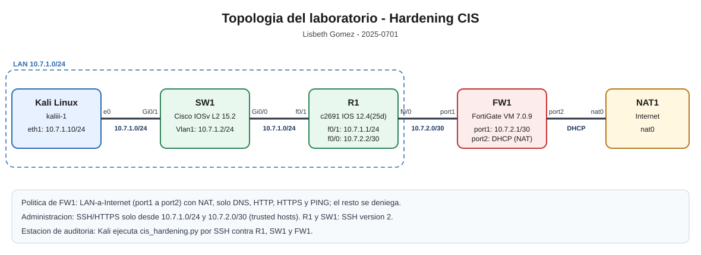

# 02 · Topología y direccionamiento

## Diagrama

Captura de la topología en GNS3: `images/capturas/01-topologia-gns3.png`

## Conexiones

| Origen | Destino | Red del enlace |
|---|---|---|
| Kali `eth1` | SW1 `Gi0/1` | 10.7.1.0/24 |
| SW1 `Gi0/0` | R1 `f0/1` | 10.7.1.0/24 |
| R1 `f0/0` | FW1 `port1` | 10.7.2.0/30 |
| FW1 `port2` | NAT1 (`nat0`) | DHCP del NAT de GNS3 |

## Direccionamiento IP

| Equipo | Interfaz | Dirección | Notas |
|---|---|---|---|
| Kali | eth1 | 10.7.1.10/24 | Puerta de enlace 10.7.1.1 |
| SW1 | Vlan 1 | 10.7.1.2/24 | Puerta de enlace 10.7.1.1 |
| R1 | f0/1 | 10.7.1.1/24 | Puerta de enlace de la LAN |
| R1 | f0/0 | 10.7.2.2/30 | Ruta por defecto vía 10.7.2.1 |
| FW1 | port1 | 10.7.2.1/30 | Ruta a 10.7.1.0/24 vía 10.7.2.2 |
| FW1 | port2 | DHCP | Ruta por defecto por DHCP; NAT hacia Internet |

## Flujo de tráfico

1. Kali envía su tráfico a R1 (puerta de enlace de la LAN).
2. R1 reenvía todo lo desconocido hacia FW1 (`10.7.2.1`). R1 no hace NAT.
3. FW1 aplica la política **LAN-a-Internet** (port1 → port2) con NAT y solo permite DNS, HTTP, HTTPS y PING. Todo lo demás cae en la denegación implícita.
4. El tráfico de regreso vuelve por la ruta `10.7.1.0/24` vía `10.7.2.2`.

## Administración

- R1, SW1 y FW1 se administran por SSH desde Kali.
- FW1 limita la administración a `10.7.1.0/24` y `10.7.2.0/30` mediante *trusted hosts*.
- La configuración inicial de cada equipo está en [`configs/initial/`](../configs/initial/).
